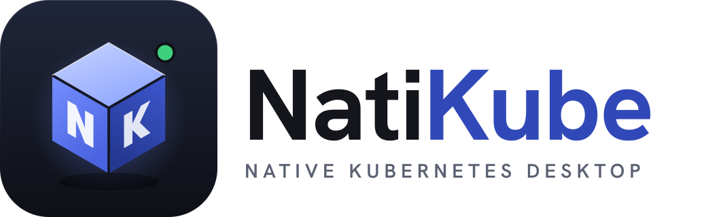
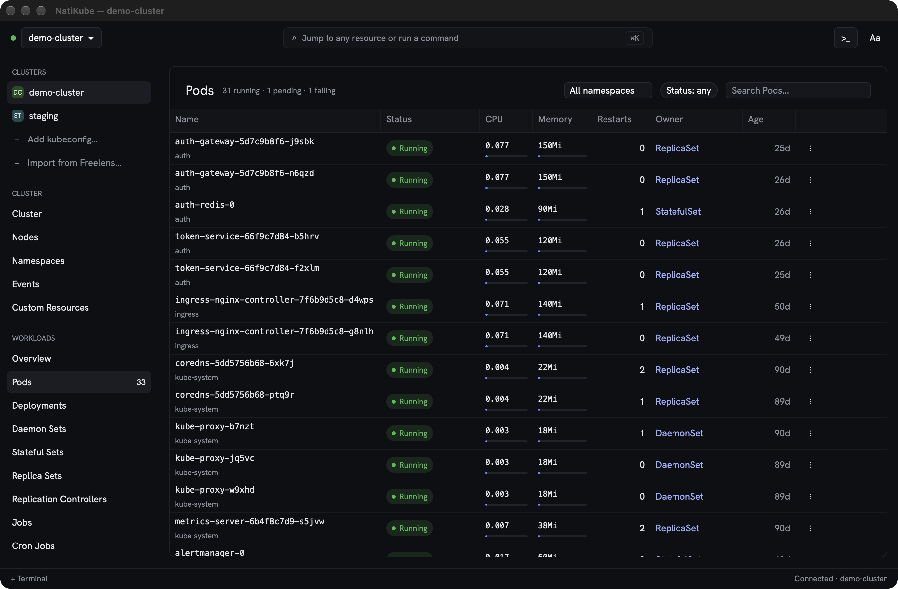
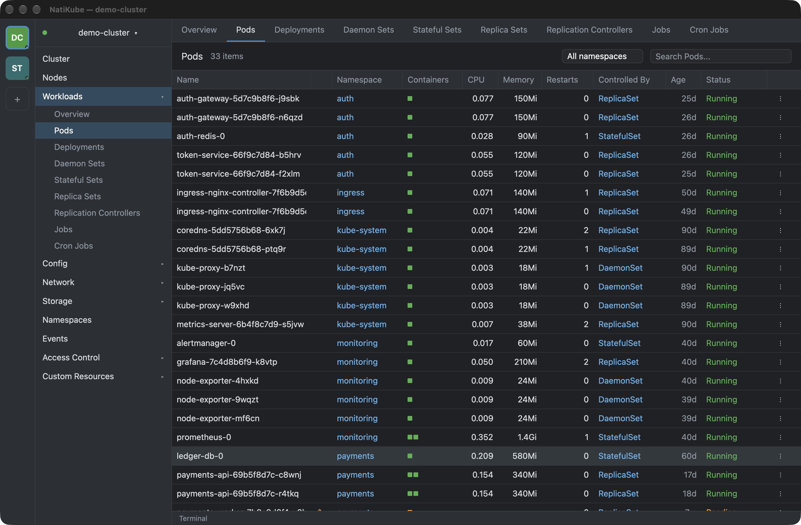
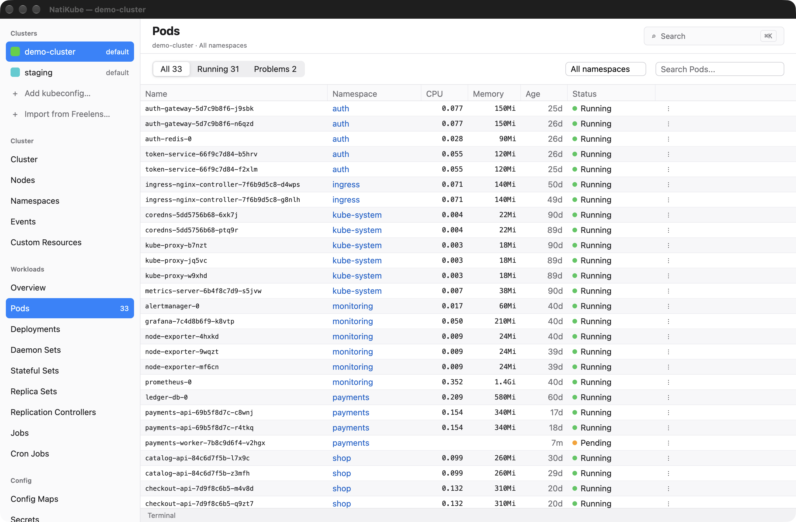
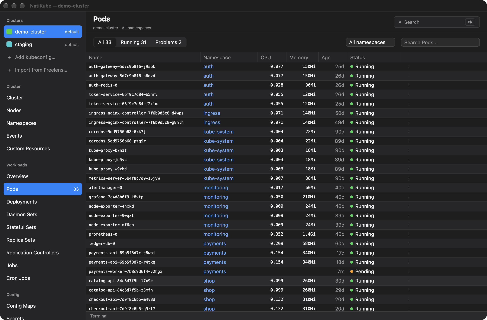
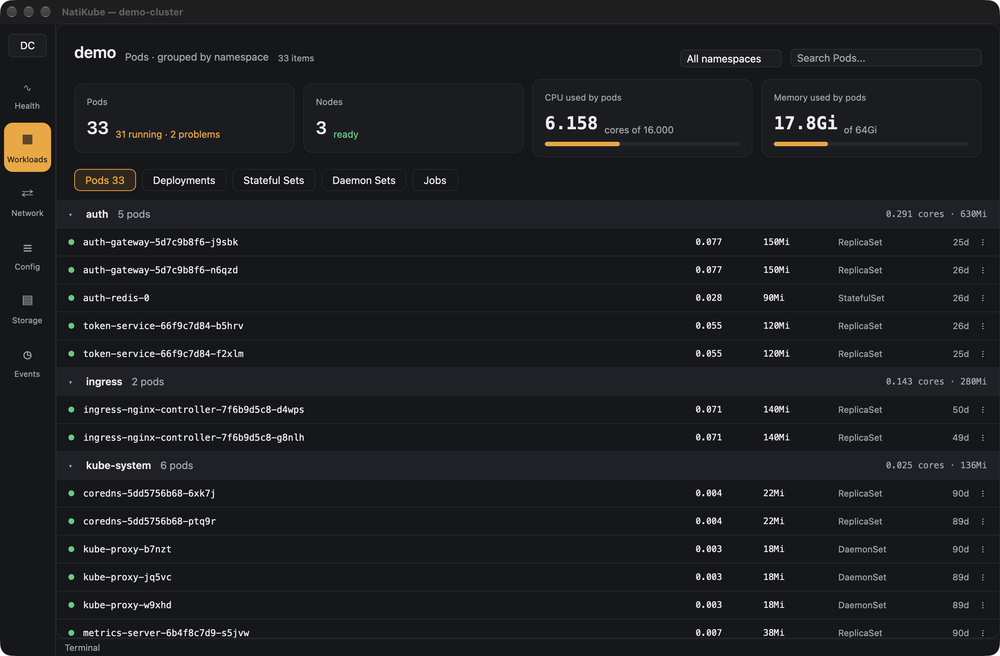
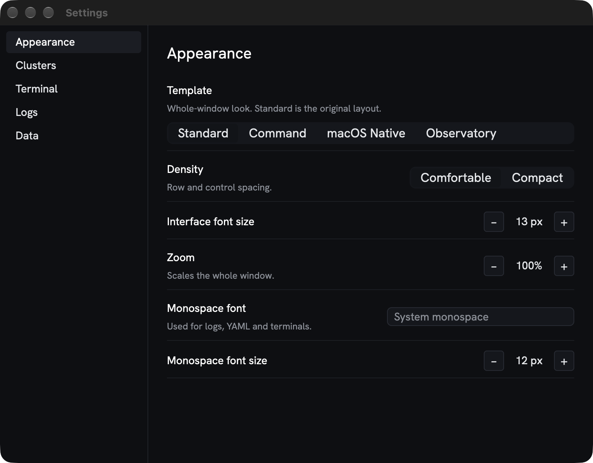

<div align="center">

<picture>
  <source media="(prefers-color-scheme: dark)" srcset="assets/icon/natikube-wordmark-dark.svg">
  <source media="(prefers-color-scheme: light)" srcset="assets/icon/natikube-wordmark-light.svg">
  
</picture>

**A fast, 100% native Kubernetes desktop app. Rust and GPUI: no Electron, no webview, no bundled kubectl.**

[](LICENSE)
[](#install)
[](https://www.rust-lang.org)
[](https://www.gpui.rs)



</div>

## Gallery

Four appearances, switchable live. Every screenshot below was taken with `--demo`, a fictional cluster built into the app.

| | |
| :---: | :---: |
| <br>**Standard**: the familiar cluster rail, sidebar and tabs. | <br>**Command**: top bar, stacked names, status pills and usage bars. |
| <br>**Native (light)**: source-list sidebar and zebra rows. | <br>**Native (dark)**: follows the system light or dark setting. |
| <br>**Observatory**: icon rail, KPI cards, pods grouped by namespace. | <br>**Settings**: template, density, fonts, zoom, terminal, logs and data. |

## Features

- **Fast and light.** A single native binary of about 20 MB. The first frame shows in a few hundred milliseconds and lists are virtualized, so a 10,000-row list stays smooth.
- **Browse everything.** Workloads, nodes, namespaces, events, config, network, storage, access control and Custom Resources discovered from the cluster's CRDs. Live updates through watches, with CPU and memory from metrics.
- **Detail panel.** Overview, YAML editor with apply, scale and delete, events and Secret keys.
- **Logs.** Streaming pod logs with tail, timestamps and wrapping.
- **Terminals.** `exec` into a container, or open a local shell (PowerShell, `cmd` or your Unix shell) in the dock.
- **Port forwarding.** Start, list and stop forwards, and open them in the browser.
- **Command palette.** `Ctrl/Cmd+K` jumps to any resource, view or command.
- **Many clusters.** Reads every kubeconfig it finds, folds duplicates (including EKS alias and ARN twins) and imports the cluster list from Freelens.
- **Four appearances and a Settings window**, all applied live and saved as plain JSON.

## Install

Download the latest build from [GitHub Releases](../../releases/latest). The builds are not code-signed or notarized (no paid certificates), so your OS asks for confirmation the first time.

### macOS (Apple Silicon)

1. Download `NatiKube-<version>-macos-arm64.dmg`, open it and drag **NatiKube** to **Applications**.
2. Remove the quarantine flag:

   ```sh
   xattr -dr com.apple.quarantine /Applications/NatiKube.app
   ```

3. On macOS 15 and later, if the app is still blocked: **System Settings > Privacy & Security**, scroll to the message about NatiKube and choose **Open Anyway**.

### Windows (x64)

1. Download `NatiKube-<version>-windows-x64.zip` and extract it.
2. Run `natikube.exe`. If SmartScreen shows "Windows protected your PC", choose **More info**, then **Run anyway**.

### Verify your download

Each file has a matching `.sha256`. Put both in the same folder and run:

```sh
shasum -a 256 -c NatiKube-<version>-macos-arm64.dmg.sha256      # macOS
```

```powershell
(Get-FileHash NatiKube-<version>-windows-x64.zip).Hash.ToLower() # Windows: compare with the .sha256 file
```

### Homebrew

A Homebrew cask is **coming soon**. A template lives in [`packaging/homebrew`](packaging/homebrew/natikube.rb).

## Build from source

You need a recent stable Rust toolchain (see `rust-toolchain.toml`).

```sh
cargo build --release
./target/release/natikube                    # your current kubeconfig context
./target/release/natikube --demo             # a fictional cluster, no kubeconfig needed
```

Packaging: `scripts/package-macos.sh` builds the signed-ad-hoc `.app` and a DMG, `scripts/package-windows.ps1` builds the ZIP.

Useful flags: `--context <name>`, `--demo`, `--appearance <standard|command|native|observatory>`, `--native-mode <light|dark>`, `--open-settings`, `--dump-clusters`, `--dump <kind>`, `--fake-rows <N>`, `--exit-after-first-frame`. Run `natikube --help` for the list. Appearance flags apply to one run and are never saved.

On Windows release builds the app is a GUI-subsystem executable, so CLI flags (`--help`, `--dump-clusters`, `--dump <kind>`, ...) print nothing to the terminal. Use a debug build (`cargo run -- --dump-clusters`) when you need their output.

Checks:

```sh
cargo fmt --all -- --check
cargo clippy --workspace --all-targets -- -D warnings
cargo test --workspace
```

## Keyboard shortcuts

| Shortcut | Action |
| --- | --- |
| `Cmd+K` (`Ctrl+K` on Windows) | Command palette |
| `Cmd+,` (`Ctrl+,` on Windows) | Settings |
| `Cmd+M` (`Ctrl+M` on Windows) | Minimize |
| `Cmd+Q` (`Ctrl+Q` on Windows) | Quit |

In terminals, copy and paste are `Cmd+C` / `Cmd+V` on macOS and `Ctrl+Shift+C` / `Ctrl+Shift+V` elsewhere, so plain `Ctrl+C` still interrupts.

## Kubeconfig discovery

NatiKube reads every kubeconfig in `~/.kube/` (top-level files), `$KUBECONFIG` and any files or folders you add in Settings > Clusters. Identical contexts (same server, user and namespace) are folded into one entry, preferring `~/.kube/config`, then `$KUBECONFIG` order, then the other files. EKS contexts show their short cluster name instead of the ARN. **Import from Freelens** adds the kubeconfig paths from Freelens' cluster store. On Windows the folder is `%USERPROFILE%\.kube`.

Settings live in `~/Library/Application Support/NatiKube/settings.json` on macOS and `%APPDATA%\NatiKube\settings.json` on Windows. A file with a syntax error is kept as a `.bak` and never overwritten.

## Architecture

Vertical feature slices over a small core, with no feature depending on another. See [`docs/architecture.md`](docs/architecture.md).

## Acknowledgements

- Built on [GPUI](https://www.gpui.rs) through [GPUI Kit](https://github.com/longbridge/gpui-kit), [kube-rs](https://kube.rs), [Tokio](https://tokio.rs) and [alacritty_terminal](https://github.com/alacritty/alacritty).
- The Command appearance embeds the [Hanken Grotesk](https://fonts.google.com/specimen/Hanken+Grotesk) font under the SIL Open Font License ([`assets/icon/HankenGrotesk-OFL.txt`](assets/icon/HankenGrotesk-OFL.txt)).
- Licenses of every dependency are listed in [`packaging/THIRD-PARTY-NOTICES.md`](packaging/THIRD-PARTY-NOTICES.md), which also ships inside each download.

## License

[MIT](LICENSE) © 2026 [Paul Osinga](https://github.com/paulpwo)
